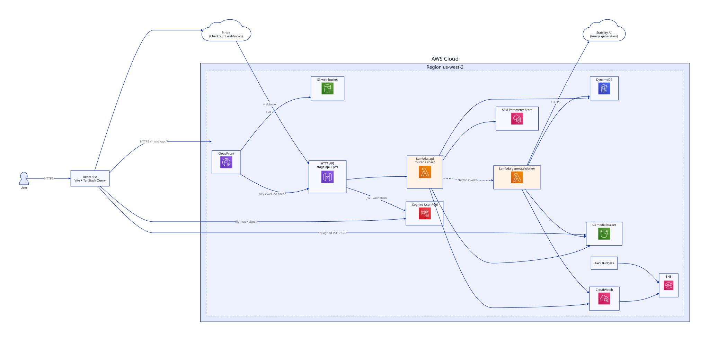

# AWS Token Designer

A port of the Firebase Token Designer to AWS. Users generate or upload token images, arrange up to 63 of them on a printable sheet, and print it.

**Status:** Plan drafted; awaiting review. Implementation not started.

## Links

- Repo: https://github.com/tlewismedia/aws-token-designer
- Kanban board: https://github.com/users/tlewismedia/projects/7
- Issues: https://github.com/tlewismedia/aws-token-designer/issues

## Documentation

| Doc | Purpose |
|---|---|
| [`PRE_PLANNING.md`](PRE_PLANNING.md) | Discussion record and decision log |
| [`docs/PLAN.md`](docs/PLAN.md) | Official implementation plan |
| [`docs/REQUIREMENTS.md`](docs/REQUIREMENTS.md) | Functional/non-functional requirements (FR/NFR) |
| [`docs/RAID.md`](docs/RAID.md) | Risks, assumptions, issues, dependencies |
| [`docs/ARCHITECTURE.md`](docs/ARCHITECTURE.md) | Architecture document and diagrams |
| [`docs/PUBLIC_SAFE.md`](docs/PUBLIC_SAFE.md) | Public repository policy and checklist |
| [`docs/adr/README.md`](docs/adr/README.md) | Architecture Decision Records index and template |
| [`docs/AGENTS.md`](docs/AGENTS.md) | Agent orchestration rules (implementer/reviewer workflow) |
| [`docs/TESTING.md`](docs/TESTING.md) | Automated checks, manual smoke checklist, deployed-dev status |
| [`docs/diagrams/README.md`](docs/diagrams/README.md) | Diagram generation and polish workflow |

## Planned Stack

- **Frontend:** Vite + React 19 + TypeScript, TanStack Query v5, Amplify Auth v6
- **Auth:** Amazon Cognito
- **API:** API Gateway HTTP API + Lambda (Node 22)
- **Data:** DynamoDB (single table, on-demand)
- **Files:** private S3 + presigned URLs
- **AI:** Stability AI via async worker Lambda
- **Payments:** Stripe embedded checkout
- **Hosting:** S3 + CloudFront (same-origin `/api/*` proxy)
- **IaC:** Terraform >= 1.10
- **Region:** us-west-2

## Diagrams

- [Polished AWS deployment view](docs/diagrams/aws-deployment.svg)
- [Diagram workflow](docs/diagrams/README.md)

## Security

This repository may be public. Do not commit secrets, Terraform state, or personal data. See [`docs/PUBLIC_SAFE.md`](docs/PUBLIC_SAFE.md).

## License

TBD.
