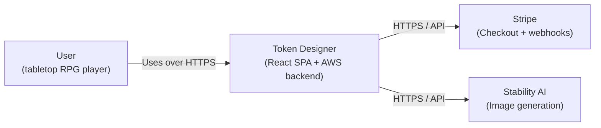
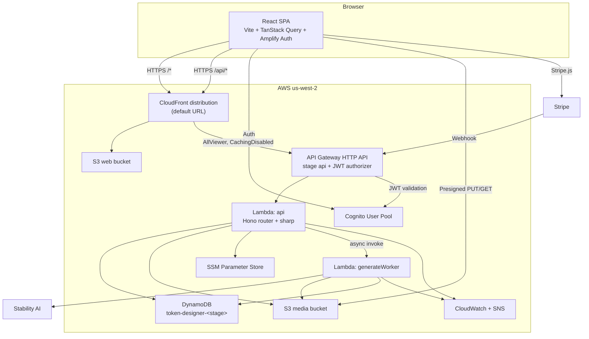
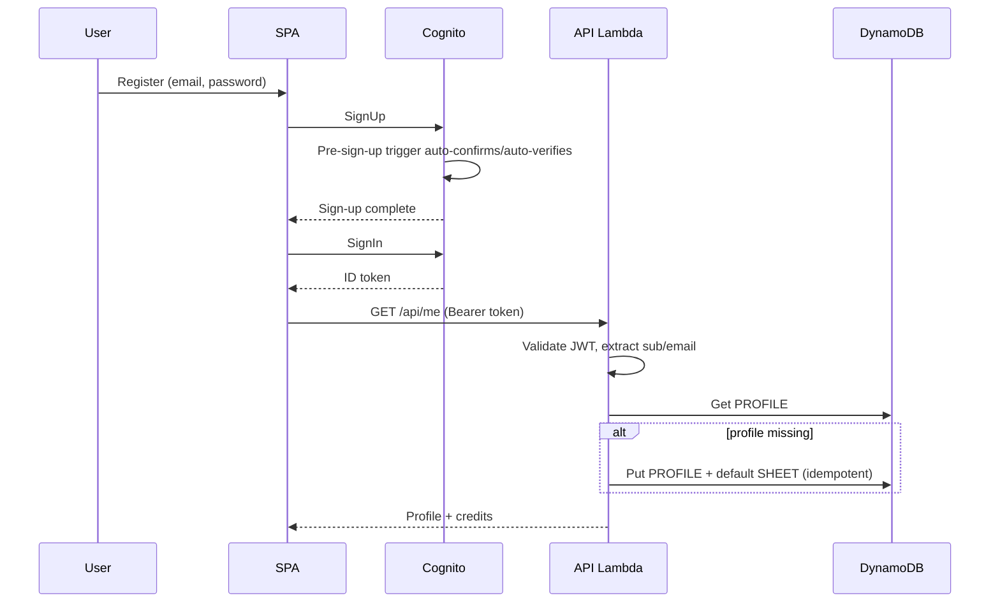
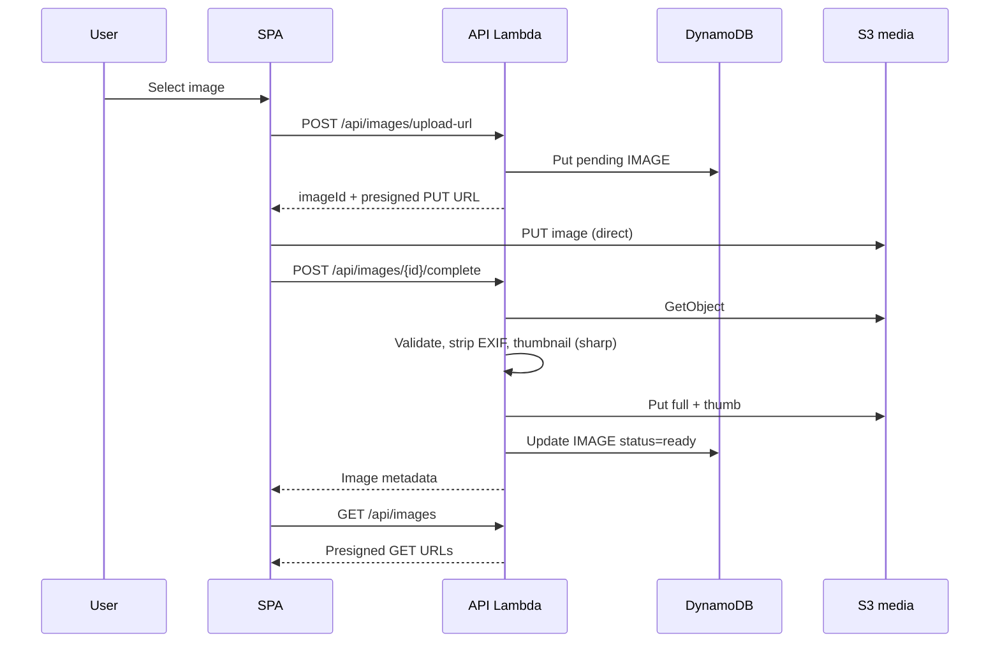
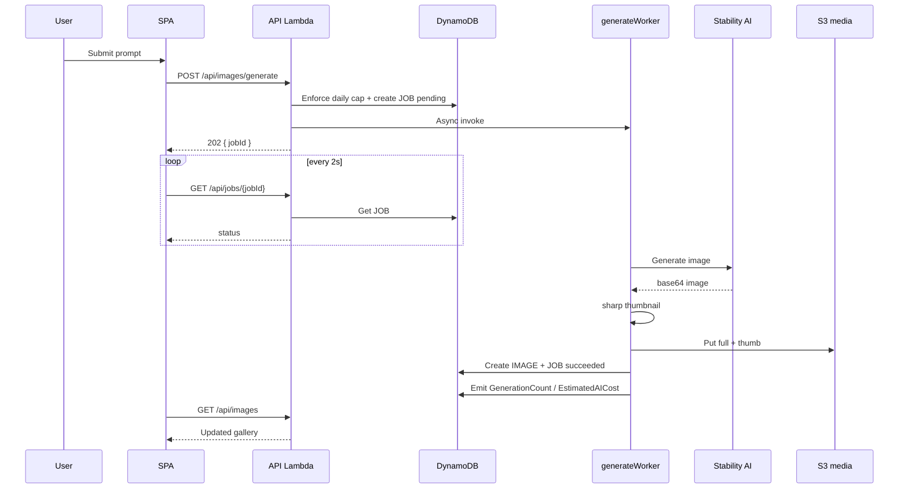
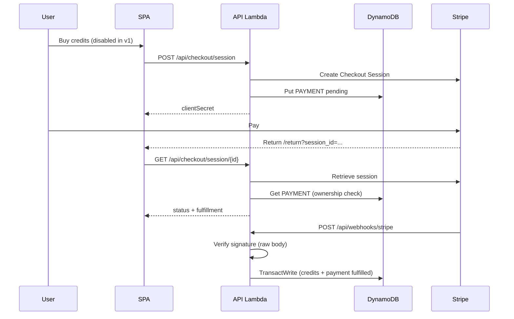
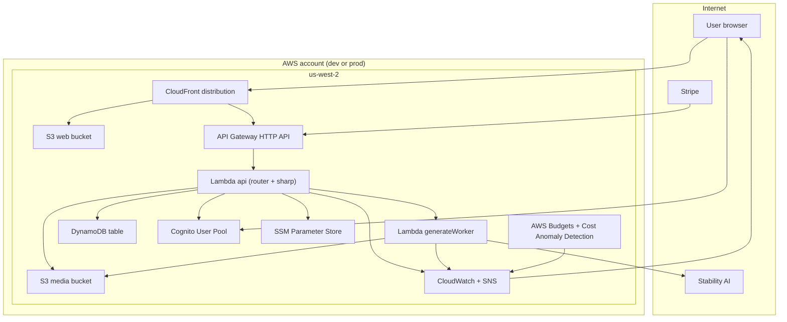
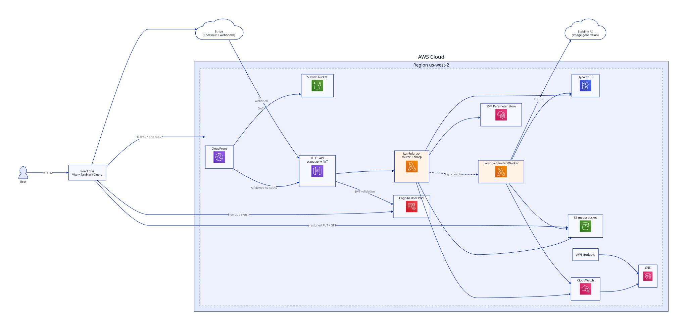

# AWS Token Designer — Architecture

| Field | Value |
|---|---|
| Status | Proposed |
| Version | 1.0 |
| Date | 2026-11-09 |
| Owner | Tom |
| Related | `docs/PLAN.md`, `PRE_PLANNING.md`, `docs/PUBLIC_SAFE.md`, `docs/adr/` |

This is an **arc42-lite** Solution Architecture Document. It focuses on the context, containers, runtime flows, deployment, and crosscutting concerns for the AWS port of the Firebase Token Designer. It is intentionally concise; implementation detail lives in `docs/PLAN.md`.

---

## 1. Introduction and Goals

The app lets a tabletop RPG user generate or upload token images, arrange up to 63 of them on a printable sheet, and print it. The Firebase version uses Auth, Firestore, Storage, Cloud Functions, and Stripe. This port moves those responsibilities to AWS while preserving behavior.

**Top goals:**

1. Functional parity with the Firebase app.
2. Near-zero infrastructure cost at demo traffic.
3. Terraform-managed, reproducible `dev` and `prod` environments.
4. Security issues in the source app fixed during the port.
5. Clear, reviewable architecture documentation.

**Non-goals:** custom domain, real-time sync, data migration, multi-sheet UI, account page, purchase enablement, print-quality improvements, social login/MFA/password reset.

---

## 2. Constraints

- **Region:** `us-west-2` (Oregon); no cost penalty vs us-east-1.
- **Runtime:** Node.js 22 on Lambda; Node 22 locally via `.nvmrc`.
- **IaC:** Terraform >= 1.10, S3 native state lock.
- **No VPC:** Lambda runs outside a VPC to avoid NAT Gateway costs; AWS service access via public endpoints.
- **Default AWS URLs:** no Route 53, ACM, or custom domain in v1.
- **Demo traffic:** low volume; no SLA; free-tier guardrails.
- **Auth:** Cognito Essentials; custom forms; auto-confirm for demo.
- **AI:** Stability AI `stable-image/generate/ultra`; costs accepted with caps.
- **Payments:** Stripe embedded checkout, unchanged flow.

---

## 3. Context and Scope

### 3.1 System Context

**System boundary:** the SPA runs in the user's browser. CloudFront, API Gateway, Lambda, DynamoDB, S3, and Cognito are containers *inside* the Token Designer system.

**External systems:**

- **Stripe** — embedded checkout, webhook events.
- **Stability AI** — image generation API.

**Actors:** authenticated user; anonymous visitor (marketing page).

### 3.2 Scope

In scope: auth, profile/credits, image generation/upload/gallery, token sheets, print, Stripe checkout/return, hosting.

Out of scope: custom domain, migration, real-time, multi-sheet, account page, purchase enablement, print quality, social/MFA/reset.

---

## 4. Solution Strategy

| Concern | Strategy |
|---|---|
| Auth | Cognito user pool + Amplify Auth v6; custom forms; pre-sign-up auto-confirm |
| API | API Gateway HTTP API + Lambda; Cognito JWT authorizer; one `api` Lambda with a router |
| Data | DynamoDB single table; `USER#` partition; ULID sort keys; on-demand |
| Files | Private S3; presigned PUT uploads; presigned GET reads |
| AI | Async job: API returns `jobId`; worker Lambda calls Stability; client polls |
| Payments | Stripe embedded checkout; execute-api webhook; idempotent DynamoDB transaction |
| Hosting | CloudFront + S3; same-origin `/api/*` proxy; no CORS |
| IaC | Terraform modules + per-env state; bootstrap for state bucket |
| Cost | Free-tier-first; budgets/anomaly detection; daily AI cap; kill switch |
| Observability | Structured logs; CloudWatch alarms; SNS email |

---

## 5. Building Block View

### 5.1 Container Diagram

### 5.2 Building Blocks

| Block | Responsibility |
|---|---|
| **SPA** | React UI, auth state, TanStack Query cache, API client, print |
| **CloudFront** | Serve SPA from S3; proxy `/api/*` to API Gateway; security headers |
| **S3 web** | Static Vite build; private; OAC |
| **API Gateway** | HTTP routing, Cognito JWT authorizer, throttling, access logs |
| **Lambda `api`** | Profile, sheets, image presign/list/complete/delete (incl. EXIF stripping + thumbnail), jobs, checkout, webhook |
| **Lambda `generateWorker`** | Stability call, S3 writes, image record, job status, AI metrics |
| **DynamoDB** | Profiles, images, sheets, payments, jobs, daily caps |
| **S3 media** | Full and thumbnail images; private; presigned access |
| **Cognito** | User pool, email sign-in, JWT issuance |
| **SSM** | Stripe/Stability secrets, generation kill switch |
| **CloudWatch/SNS** | Logs, metrics, alarms, email notifications |

---

## 6. Runtime View

### 6.1 Registration and Login

### 6.2 Image Upload

### 6.3 AI Generation

### 6.4 Payment and Webhook

---

## 7. Deployment View

### 7.1 Living deployment view (Mermaid)

### 7.2 AWS deployment view (D2 snapshot)

Source: [`diagrams/aws-deployment.d2`](diagrams/aws-deployment.d2). Regenerate with `./scripts/render-diagram.sh`. This is the D2 snapshot; the Mermaid views above are the living, PR-reviewed views. See [`diagrams/README.md`](diagrams/README.md).

**Environments:** `dev` and `prod`, separate Terraform state, same module composition. Dev resources may be destroyed; prod stateful resources use `prevent_destroy`.

**No VPC:** all Lambda functions run outside a VPC. Internet access for Stripe/Stability is direct; AWS services are reached via public endpoints.

---

## 8. Crosscutting Concepts

### 8.1 Authentication and Authorization

- Cognito issues JWTs; API Gateway validates them via the JWT authorizer.
- Lambda derives `sub` and `email` from claims; never trusts request bodies for identity.
- Every DynamoDB item is scoped to `USER#`; handlers verify path IDs belong to the caller.
- The Stripe webhook is the only unauthenticated write path; it is protected by signature verification.

### 8.2 Data Protection

- S3 buckets are private; public access blocked; SSE-S3.
- Media reads use short-lived presigned URLs (1 hour).
- Uploads use presigned PUT with content-type/size constraints; server re-encodes to strip EXIF.
- No secrets in the repo, frontend env, or logs; SSM SecureString for server secrets.
- Error responses omit stack traces and internal details.

### 8.3 Reliability and Failure Handling

- Payment fulfillment is idempotent via a DynamoDB transaction keyed on payment status.
- Webhook returns 5xx on transient failures so Stripe retries.
- Generation jobs record terminal failure; client stops polling.
- DynamoDB on-demand absorbs bursts; SDK retries with backoff.
- No real-time sync; TanStack Query refetches on focus and after mutations.

### 8.4 Observability

- Structured JSON logs with request IDs; secrets/tokens redacted.
- CloudWatch metrics: Lambda errors/throttles, API 5xx/latency, DynamoDB throttles, generation count/cost, webhook failures.
- Alarms → SNS → email (private address; placeholder in public docs).
- Budgets and Cost Anomaly Detection.
- CloudTrail management events enabled.

### 8.5 Cost

- Free-tier-first: Lambda, CloudFront, Cognito Essentials, DynamoDB storage, CloudWatch logs.
- Avoid: NAT Gateway, Secrets Manager, WAF, customer-managed KMS keys, provisioned concurrency, RDS/OpenSearch.
- Guardrails: budgets, anomaly detection, reserved concurrency, API throttling, daily AI cap, kill switch.
- Estimated AWS cost at demo traffic: ~$0–1/month; AI and Stripe are usage-based.

### 8.6 Deployment and Operations

- Terraform modules + per-env state; bootstrap state bucket; `prevent_destroy` in prod.
- Build Lambda bundles and the sharp layer in scripts/CI; Terraform packages artifacts.
- Build the SPA, sync to S3, invalidate only `/index.html`.
- Runbook covers alarms, failed deployments, webhook failures, and rollback.

---

## 9. Architecture Decisions

ADRs live in `docs/adr/`. Planned records:

| ADR | Decision |
|---|---|
| 0001 | Use Terraform for IaC |
| 0002 | Use API Gateway HTTP API over Lambda Function URLs |
| 0003 | Use a same-origin CloudFront `/api/*` proxy |
| 0004 | Use presigned S3 for media |
| 0005 | Use DynamoDB single table, on-demand |
| 0006 | Use custom Cognito forms with auto-confirm |
| 0007 | Use the execute-api URL for the Stripe webhook |
| 0008 | Cost guardrails and AI caps |
| 0009 | Diagram tooling: living Mermaid views + D2 deployment snapshot |

---

## 10. Quality Requirements

See `docs/PLAN.md` §5.2 for the full NFR table. Summary:

- p95 CRUD < 500 ms; generation accepted < 1 s.
- Best-effort 99.9% availability for the demo.
- No secrets in repo; least privilege; OWASP Top 10 mitigations.
- AWS infra < $5/month at demo traffic.
- Structured logs, alarms, runbook; deploy < 15 minutes.
- Idempotent payments; no lost credits.
- TypeScript strict; shared schemas; automated tests.
- WCAG 2.1 AA for new/modified UI.
- No PII beyond email; no analytics.

---

## 11. Risks and Technical Debt

| Risk / Debt | Notes | Mitigation |
|---|---|---|
| `sharp` on Lambda | Native binary packaging | Docker-built arm64 layer; test early; fallback to container image |
| CloudFront `/api/*` mapping | Stage/path coupling | Verify early; execute-api fallback |
| Stripe raw-body signature | Header/body forwarding | Use execute-api URL; Stripe CLI tests |
| AI cost abuse | External spend | Daily cap, kill switch, alarms |
| Auto-confirm sign-ups | Anyone can register any email | Demo-only; rate limits; production switch to verification |
| No real-time updates | Polling/refetch only | Acceptable for demo; revisit if needed |
| Print quality | Thumbnails printed | Later improvement: full-res print |
| Single sheet UI | Only latest sheet | Later improvement |
| No custom domain | Default CloudFront URL | Later: ACM + Route 53 |
| Terraform learning curve | Team unfamiliarity | Primer, plan reviews, small increments |
| Free-tier changes | AWS policy changes | Budgets, anomaly detection, cost review |

---

## 12. Glossary

| Term | Meaning |
|---|---|
| ADR | Architecture Decision Record |
| C4 | Context, Container, Component, Code model |
| CDN | Content Delivery Network (CloudFront) |
| Cognito | AWS managed identity service |
| DynamoDB | AWS managed NoSQL database |
| HTTP API | API Gateway's lightweight HTTP API type |
| Idempotency | Safe retry behavior with no duplicate side effects |
| NFR | Non-functional requirement |
| OAC | CloudFront Origin Access Control |
| Presigned URL | Time-limited S3 URL signed with IAM credentials |
| SAD | Solution Architecture Document |
| SSM | AWS Systems Manager Parameter Store |
| ULID | Universally Unique Lexicographically Sortable Identifier |
