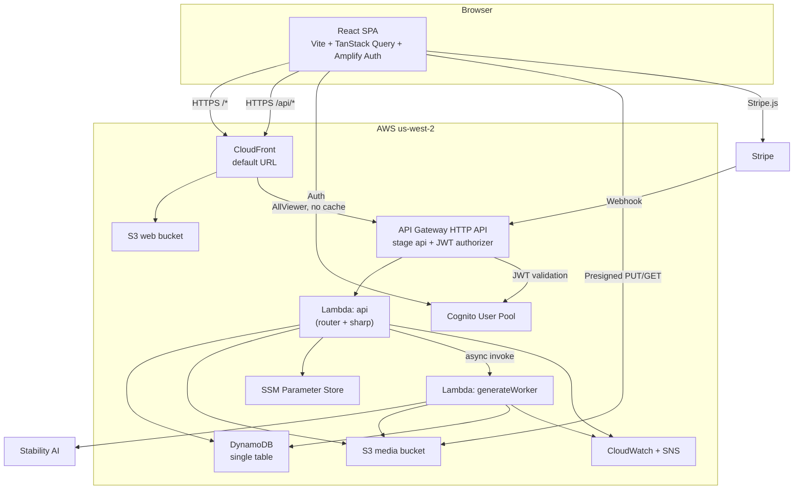

# AWS Token Designer — Implementation Plan

| Field | Value |
|---|---|
| Status | Proposed |
| Version | 1.0 |
| Date | 2026-11-09 |
| Owner | Tom |
| Source app | `/Users/tomlewis/prj/firebase-token-designer` |
| Target repo | `/Users/tomlewis/prj/aws-token-designer` |
| Related docs | `PRE_PLANNING.md`, `docs/ARCHITECTURE.md`, `docs/PUBLIC_SAFE.md`, `docs/adr/` |

---

## 1. Executive Summary

Port the Firebase Token Designer to AWS with **functional parity**, **near-zero infrastructure cost**, and **Terraform-managed infrastructure**.

The target stack:

- **Frontend:** Vite + React 19 + TypeScript, React Router v7, TanStack Query v5, Amplify Auth v6.
- **Auth:** Amazon Cognito (custom forms, auto-confirm for the demo).
- **API:** API Gateway HTTP API + Lambda (Node 22), Cognito JWT authorizer.
- **Data:** DynamoDB single table, on-demand.
- **Files:** private S3 + presigned uploads/GETs.
- **AI:** Stability AI, called from an async worker Lambda.
- **Payments:** Stripe embedded checkout + webhook (kept as-is).
- **Hosting:** S3 + CloudFront, same-origin `/api/*` proxy to API Gateway.
- **IaC:** Terraform >= 1.10, S3 native state lock, modules + per-env state.
- **Region:** `us-west-2` (Oregon).

This is a demo, not a production product yet. The plan prioritizes exact behavior, low cost, security hygiene, and clear documentation over scale and polish.

---

## 2. Goals and Non-Goals

### Goals

1. Reproduce the current user flows: register/login/logout, profile + credits, image generation, image upload, gallery, token sheet add/remove/clear/delete, print, checkout/return.
2. Keep AWS infrastructure at roughly **$0–2/month** at demo traffic, excluding AI and Stripe usage.
3. Make infrastructure reproducible from code with Terraform (`dev` and `prod`).
4. Fix the security issues identified in the source app (secrets, authz, ownership, webhook handling).
5. Document architecture, decisions, costs, security, and operations so the project can be reviewed and extended.
6. Use TanStack Query for server state; remove Firestore-style subscription plumbing.

### Non-Goals (for v1)

- No Firebase data or auth migration (no real users).
- No custom domain, Route 53, or ACM (use AWS default URLs).
- No real-time updates (polling + refetch-on-focus instead).
- No multiple-sheet UI, account page, or purchase enablement (preserve current behavior).
- No print-quality improvement (keep thumbnail printing for now).
- No social login, MFA, password reset, or email verification.
- No mobile app, analytics, or marketing automation.
- No multi-region, DR, or high-availability guarantees beyond what the managed services provide.

---

## 3. Confirmed Decisions

| # | Decision |
|---|---|
| 1 | Exact functional port for now; improvements later. |
| 2 | No data/auth migration; start clean. |
| 3 | Keep Stability AI; AI costs acceptable with guardrails. |
| 4 | Keep Stripe embedded checkout flow as-is. |
| 5 | Hybrid local dev (local Vite + dev AWS resources). |
| 6 | Cost strategy documented; budgets/alerts enabled. |
| 7 | AWS default URLs for now; custom domain deferred. |
| 8 | Fix security issues during the port. |
| 9 | Custom React auth forms + Amplify Auth v6. |
| 10 | Simplest login UX: auto-confirm, no verification/reset/MFA. |
| 11 | Terraform for IaC. |
| 12 | API Gateway HTTP API (not Function URLs). |
| 13 | Presigned S3 for media (CloudFront signed URLs later). |
| 14 | DynamoDB on-demand. |
| 15 | Region: us-west-2. |
| 16 | Terraform: S3 native state lock, modules + env dirs. |
| 17 | Lambda packaging: zip + Docker-built arm64 `sharp` layer. |
| 18 | Manual `terraform apply` first; GitHub Actions OIDC later. |
| 19 | Same-origin CloudFront `/api/*` proxy; no CORS. |
| 20 | Budget alerts to a private address (placeholder in public docs). |
| 21 | Generation stays free (current behavior) with a per-user daily cap. |
| 22 | Print thumbnails for now. |
| 23 | npm workspaces repo layout. |
| 24 | Node 22 pinned via `.nvmrc`. |
| 25 | Keep `orders@example.com` on the Return page for now. |
| 26 | Stripe webhook uses the execute-api URL (Option A). |
| 27 | Repository may be public with a public-safe policy. |

---

## 4. Architecture Overview

Full diagrams and runtime views: [`docs/ARCHITECTURE.md`](ARCHITECTURE.md).



**Key design choices:**

- **Same-origin CloudFront proxy:** the SPA calls relative `/api/...`; CloudFront forwards to API Gateway. No CORS, no custom domain, no circular build dependency.
- **Async generation:** API returns `jobId` immediately; worker Lambda calls Stability; client polls with TanStack Query. Avoids the 30s API Gateway timeout.
- **Presigned S3:** browser uploads directly to S3; API returns short-lived GET URLs. Avoids API payload limits and CloudFront key management.
- **Synchronous upload processing:** the `api` Lambda validates and thumbnails uploads with `sharp`; no separate event processor or polling loop.
- **Single DynamoDB table:** all entities scoped to `USER#<sub>`; sortable ULIDs; on-demand capacity.
- **Lazy profile bootstrap:** first authenticated `GET /api/me` creates profile + default sheet idempotently.

---

## 5. Requirements

### 5.1 Functional Requirements

| ID | Requirement | Acceptance |
|---|---|---|
| FR-1 | Register, login, logout with email/password | Cognito user created; session persists; logout clears session and query cache |
| FR-2 | Show user profile and credit balance | Navbar shows credits from `GET /api/me` |
| FR-3 | Create default sheet on first login | Profile bootstrap creates `PROFILE` + one `SHEET` idempotently |
| FR-4 | Generate an image from name, description, style, negative prompt | Job created; image appears in gallery after polling |
| FR-5 | Upload an image via drag/drop or file picker | Max 10 MB; image types only; thumbnail created; appears in gallery |
| FR-6 | List generated/uploaded images with thumbnails | Gallery loads presigned thumb URLs |
| FR-7 | Add an image to the latest sheet | Max 63 tokens; duplicate adds allowed as in source |
| FR-8 | Remove a token from the sheet | Removes by index; sheet updates |
| FR-9 | Clear the sheet | `images` becomes empty |
| FR-10 | Delete an image | S3 full + thumb deleted; DB item deleted; removed from all sheets |
| FR-11 | Print the sheet | Browser print dialog; up to 63 tokens |
| FR-12 | Stripe checkout + return page status | Checkout session created; return page shows fulfillment state; purchase UI stays disabled |
| FR-13 | Marketing page when logged out; builder when logged in | Matches current Home behavior |
| FR-14 | Protected routes for checkout/return | Unauthenticated users redirected to `/login` |

### 5.2 Non-Functional Requirements

| ID | Requirement | Target / Verification |
|---|---|---|
| NFR-1 | Performance | p95 CRUD < 500 ms; generation accepted < 1 s; image load < 2 s on broadband; measured via CloudWatch/API Gateway metrics |
| NFR-2 | Availability | Best-effort 99.9% monthly for demo; no SLA |
| NFR-3 | Security | No secrets in repo; all routes authenticated except webhook/health; least-privilege IAM; OWASP Top 10 mitigations; gitleaks clean |
| NFR-4 | Cost | AWS infra < $5/month at demo traffic; budgets at $1/$5/$10/$25; AI daily cap enforced |
| NFR-5 | Operability | Structured logs, alarms, runbook; deploy < 15 minutes; rollback documented |
| NFR-6 | Reliability | Payment fulfillment idempotent; transient webhook failures return 5xx; no lost credits |
| NFR-7 | Maintainability | TypeScript strict; shared zod schemas; unit + integration + E2E tests |
| NFR-8 | Accessibility | WCAG 2.1 AA for new/modified UI; preserve current baseline |
| NFR-9 | Data retention | Images retained until user deletes; no PII beyond email |
| NFR-10 | Privacy | No analytics/tracking; no third-party scripts beyond Stripe.js |

---

## 6. Technical Design

### 6.1 Repository Layout

```
aws-token-designer/
  apps/
    web/                     # Vite + React 19 + TS
      src/
        app/                 # router, providers, layout
        features/
          auth/
          images/
          sheets/
          billing/
        components/          # shared UI (Button, Modal, Logo, etc.)
        lib/
          api/               # fetch wrapper, query keys, hooks
          query/             # QueryClient config
      public/
  services/
    api/                     # Hono router + route handlers
    workers/
      generate/              # Stability worker
  packages/
    shared/                  # types, zod schemas, constants
  infra/
    bootstrap/               # state bucket + lock
    modules/
      cognito/
      dynamodb/
      storage/
      lambda/
      api/
      cloudfront/
      monitoring/
    envs/
      dev/
      prod/
  docs/
    PLAN.md
    ARCHITECTURE.md
    PUBLIC_SAFE.md
    REQUIREMENTS.md          # extracted from this plan in Phase 0
    COSTS.md
    SECURITY.md
    RUNBOOK.md
    TESTING.md
    TERRAFORM.md
    RAID.md
    adr/
    diagrams/
  scripts/
    build-lambda.sh
    build-sharp-layer.sh
    deploy-web.sh
    render-diagram.sh
    seed-dev.ts
  .nvmrc                     # 22
  package.json               # npm workspaces
```

### 6.2 Frontend

- **Vite + React 19 + TypeScript strict.**
- **React Router v7** with the current route map: `/`, `/login`, `/register`, `/dashboard` (under construction), `/buy-credits`, `/return`, `*`.
- **Amplify Auth v6** (`aws-amplify/auth` only) for Cognito.
- **TanStack Query v5** for all server state.
- **Zod** for API response validation where useful; shared request/response schemas in `packages/shared`.
- **No Zustand for server state.** Use React state for modal open/close and local UI.
- **Thin `AuthContext`** exposing `user`, `signIn`, `signOut`, `signUp`, `getIdToken`.
- **ProtectedRoute** redirects to `/login`.
- **Query client defaults:** `staleTime: 30s`, `retry: 1`, `refetchOnWindowFocus: true`.
- **Query keys:** `['profile', sub]`, `['images', sub]`, `['sheets', sub]`, `['job', jobId]`.
- **Mutations:** invalidate related queries; optimistic updates for add/remove token and clear sheet.
- **API client:** `fetch` wrapper that attaches `Authorization: Bearer <idToken>`, parses JSON, throws typed errors, and signs out on 401.
- **Vite dev proxy:** `/api` → dev execute-api or CloudFront URL, so the browser sees same-origin requests.
- **Env vars (public only):** `VITE_AWS_REGION`, `VITE_COGNITO_USER_POOL_ID`, `VITE_COGNITO_CLIENT_ID`, `VITE_STRIPE_PUBLISHABLE_KEY`.

### 6.3 Auth Flow

1. User registers with email/password.
2. Cognito pre-sign-up Lambda sets `autoConfirmUser = true` and `autoVerifyEmail = true` (demo parity; documented tradeoff).
3. Amplify signs the user in and stores tokens.
4. Frontend calls `GET /api/me` with the ID token.
5. API validates the JWT via the HTTP API authorizer, extracts `sub` and `email`.
6. If no `PROFILE` exists, the API creates it (10 credits) and a default `SHEET` idempotently.
7. Logout calls Amplify `signOut`, clears the query cache, and redirects to `/`.

**Cognito config:** email sign-in, password min 8, no MFA, no advanced security, no hosted UI domain, no client secret.

### 6.4 API

**API Gateway HTTP API**, stage `api`, Cognito JWT authorizer. CloudFront forwards `/api/*` to the execute-api origin.

**Route table** (paths relative to the `api` stage; the SPA calls `/api/...`):

| Method | Path | Auth | Purpose |
|---|---|---|---|
| GET | `/health` | None | Health check |
| GET | `/me` | JWT | Profile; lazy bootstrap |
| GET | `/images` | JWT | List images + presigned thumb URLs |
| POST | `/images/upload-url` | JWT | Create pending image + presigned PUT |
| POST | `/images/{id}/complete` | JWT | Validate upload, thumbnail, mark ready |
| POST | `/images/generate` | JWT | Create job + async invoke worker |
| GET | `/jobs/{jobId}` | JWT | Job status |
| DELETE | `/images/{id}` | JWT | Delete S3 objects, DB item, sheet refs |
| GET | `/sheets` | JWT | List sheets |
| POST | `/sheets` | JWT | Create sheet |
| PATCH | `/sheets/{id}` | JWT | Update name/template/images |
| DELETE | `/sheets/{id}` | JWT | Delete sheet |
| POST | `/sheets/{id}/images` | JWT | Add image ID |
| DELETE | `/sheets/{id}/images/{index}` | JWT | Remove token by index |
| POST | `/checkout/session` | JWT | Create Stripe checkout session |
| GET | `/checkout/session/{id}` | JWT | Verify ownership + status |
| POST | `/webhooks/stripe` | None | Stripe signature verification |

**Implementation:** one `api` Lambda with a lightweight router (Hono + `@hono/aws-lambda`), zod validation, and a shared error handler. The `api` Lambda also processes uploads synchronously (validation, EXIF stripping, thumbnail) using the shared `sharp` layer. A separate `generateWorker` Lambda handles Stability generation.

**Error format:**

```json
{ "error": { "code": "INVALID_REQUEST", "message": "Human-readable message", "requestId": "..." } }
```

**Status codes:** 200/201 success, 202 accepted (job), 400 validation, 401 unauthenticated, 403 forbidden, 404 not found, 409 conflict, 413 too large, 429 throttled, 500 internal, 502 upstream failure.

### 6.5 Data Model (DynamoDB)

**Table:** `token-designer-<stage>`, on-demand, TTL enabled on `expiresAt`, AWS-owned encryption.

| Entity | PK | SK | Key attributes |
|---|---|---|---|
| Profile | `USER#<sub>` | `PROFILE` | `email`, `credits`, `createdAt`, `updatedAt` |
| Image | `USER#<sub>` | `IMAGE#<ulid>` | `entityId` (= ulid), `name`, `description`, `style`, `thumbKey`, `fullKey`, `status`, `createdAt` |
| Sheet | `USER#<sub>` | `SHEET#<ulid>` | `entityId` (= ulid), `name`, `template`, `images[]`, `createdAt` |
| Payment | `PAYMENT#<sessionId>` | `PAYMENT` | `userId`, `status`, `creditsGranted`, `processedEventIds`, timestamps |
| Job | `USER#<sub>` | `JOB#<ulid>` | `type`, `status`, `imageId`, `error`, `expiresAt` |
| Rate limit | `USER#<sub>` | `RATE#<yyyy-mm-dd>` | `count`, `expiresAt` (TTL) |

**GSI `byId`:** hash key `entityId`, projection `ALL`. Image, sheet, and job
items duplicate their ULID into `entityId` so the API can resolve a path id
across all partitions before comparing ownership (including the `403` vs
`404` answer for `GET /jobs/{jobId}`). (Other entities do not need it.)

**Access patterns:**

- Profile: `GetItem(PK, SK=PROFILE)`.
- Images newest-first: `Query(PK, begins_with(SK, "IMAGE#"), ScanIndexForward=false)`.
- Sheets newest-first: `Query(PK, begins_with(SK, "SHEET#"), ScanIndexForward=false)`.
- Latest sheet: first query result.
- Image/sheet by path id: `Query(IndexName=byId, entityId = :id)`, then compare
  the item's `PK` with `USER#<sub>`. No item → **404**; item under another
  user's partition → **403**; matching `PK` → proceed. This is the
  ownership-check pattern for `GET`/`PATCH`/`DELETE` paths and for validating
  `PATCH /sheets/{id}` `images[]` entries.
- Add/remove image: read-modify-write sheet item (max 63 IDs).
- Delete image: delete S3 objects, delete image item, update all sheets.
- Payment fulfillment: `TransactWriteItems` with a condition on payment status + credit increment.
- Daily generation cap: `UpdateItem` on a `RATE#<date>` item with a conditional increment.

### 6.6 Storage and Image Pipeline

**Buckets:** `token-designer-<stage>-web` and `token-designer-<stage>-media` (private, public access blocked, SSE-S3, OAC for CloudFront on the web bucket).

**Media keys:** `users/<sub>/images/<imageId>/full.png`, `users/<sub>/images/<imageId>/thumb.png`.

**Upload flow:**

1. `POST /api/images/upload-url` validates metadata, creates a pending `IMAGE` item, and returns a presigned S3 PUT URL (exact content-length signed; content type enforced by the request schema and magic-byte validation) and `imageId`.
2. Browser uploads directly to S3.
3. `POST /api/images/{id}/complete` fetches the object, validates magic bytes, strips EXIF, re-encodes, creates the 512px thumbnail with `sharp`, writes full + thumb, and marks the image `ready`. This runs synchronously in the `api` Lambda (sharp layer attached); no separate event processor.
4. Client invalidates `['images', sub]`.

**Read flow:** `GET /api/images` returns metadata + presigned GET URLs (1-hour TTL). TanStack Query refetches before expiry.

**Delete flow:** `DELETE /api/images/{id}` verifies ownership, deletes both S3 objects, deletes the `IMAGE` item, and removes the ID from all sheets.

**Limits:** 10 MB, `image/png`, `image/jpeg`, `image/webp`; server-side re-encode; no user-controlled paths.

### 6.7 Generation Pipeline

1. `POST /api/images/generate` validates input, enforces the per-user daily cap, creates a `JOB` item (`pending`), async-invokes `generateWorker`, returns `202 { jobId }`.
2. Worker checks the `generation-enabled` SSM kill switch, calls Stability AI (`stable-image/generate/ultra`) with prompt, negative prompt, style, 1:1, PNG.
3. Worker writes full + thumb to S3, creates the `IMAGE` item, updates `JOB` to `succeeded` or `failed`.
4. Worker emits `GenerationCount` and `EstimatedAICost` CloudWatch metrics.
5. Client polls `GET /api/jobs/{jobId}` every 2s until terminal; then invalidates images.
6. On failure, the job records the error; credits are not deducted in v1.

**Guardrails:** daily cap (default 20/user/day, `RATE#<yyyy-mm-dd>` items with
a conditional increment), kill switch (fail closed), API throttling, and the
`GenerationCount` / `EstimatedAICost` EMF metrics (namespace `TokenDesigner`,
dimension `Stage`) alarmed in the monitoring module. The worker is currently
**unreserved**: the dev account's Lambda concurrency limit is 10, so a
reservation (ADR-0008's 5) does not fit until the quota is raised. Failed
submissions still consume a daily slot (the increment runs before job
creation), which keeps the cap binding under repeated failures.

### 6.8 Payments

- Embedded Stripe Checkout, same flow as source.
- `POST /api/checkout/session` uses `sub`/email from the JWT (not the body), creates the session, writes `PAYMENT` (`pending`), returns `clientSecret`.
- `GET /api/checkout/session/{id}` verifies the payment belongs to the caller before returning status.
- `POST /api/webhooks/stripe` (execute-api URL, no authorizer) verifies the signature against the raw body and fulfills idempotently with `TransactWriteItems`.
- Purchase UI stays disabled in v1; backend is ready for later enablement.
- Price ID in SSM/config; publishable key in frontend env; secret + webhook secret in SSM SecureString.

### 6.9 TanStack Query Behavior

- Server state only; no Firestore-style subscriptions.
- Refetch on window focus + after mutations.
- Generation job polling: 2s until terminal.
- Presigned URL staleness: `staleTime` 30 min for 1-hour URLs.
- Logout: `queryClient.clear()`.
- Devtools in dev only.
- Acceptable staleness for a demo; no real-time requirement.

---

## 7. Infrastructure (Terraform)

### 7.1 Environments and State

- Environments: `dev`, `prod`; separate state files under `infra/envs/<env>`.
- Backend: S3 bucket (versioned, encrypted, public access blocked) + native S3 lock (`use_lockfile = true`).
- Bootstrap: `infra/bootstrap` creates the state bucket/lock before the first `init`.
- Stateful resources use `prevent_destroy = true` in prod; dev may be destroyed.
- Tags: `Project=token-designer`, `Stage=<env>`, `ManagedBy=terraform`.

### 7.2 Modules and Resources

| Module | Resources |
|---|---|
| `cognito` | User pool, client, pre-sign-up Lambda trigger, permission |
| `dynamodb` | Single table, TTL, on-demand |
| `storage` | Web + media buckets, public access block, ownership, SSE, CORS, lifecycle, OAC bucket policy |
| `lambda` | `api`, `generateWorker`, IAM roles, log groups, reserved concurrency, `sharp` layer |
| `api` | HTTP API, stage `api`, JWT authorizer, routes, integrations, throttling, access logs |
| `cloudfront` | Distribution, OAC, web + API origins, cache policies, response headers, SPA error responses |
| `monitoring` | SNS topic + email subscription, CloudWatch alarms, budgets, anomaly detection |

**No VPC:** Lambda runs outside a VPC so it has internet access for Stripe/Stability without a NAT Gateway. DynamoDB/S3/SSM are reached via public AWS endpoints.

### 7.3 Lambda Packaging

- esbuild bundles TypeScript to `dist/`.
- `archive_file` zips `dist/` + production dependencies.
- `sharp` is provided by a Docker-built arm64 Lambda layer (`scripts/build-sharp-layer.sh`) attached to `api` and `generateWorker`.
- `source_code_hash` triggers updates.
- Runtime `nodejs22.x`, architecture `arm64`, memory 1024 MB (`api` and `generateWorker`).
- Builds run in scripts/CI, not inside Terraform.

### 7.4 CloudFront Same-Origin Design

- Default behavior `/*` → S3 web bucket (OAC, SPA error responses 403/404 → `/index.html`).
- Behavior `/api/*` → API Gateway execute-api origin, `CachingDisabled`, `AllViewer`.
- Response headers policy: HSTS, `X-Content-Type-Options`, `Referrer-Policy`, CSP allowing self + Cognito + Stripe + media.
- Invalidate only `/index.html` on deploy.
- Default CloudFront domain for now; custom domain later without frontend changes.

### 7.5 Secrets

- SSM SecureString parameters created out-of-band (CLI/CI), never in Terraform state:
  - `/token-designer/<env>/stripe/secret`
  - `/token-designer/<env>/stripe/webhook-secret`
  - `/token-designer/<env>/stability/api-key`
  - `/token-designer/<env>/generation-enabled`
- Lambda env vars reference parameter names, not values.
- Frontend env contains only public config.

### 7.6 Monitoring and Cost Guardrails

- Budgets: $1/$5/$10/$25 alerts to a private email (placeholder in public docs).
- Cost Anomaly Detection with a low threshold.
- CloudWatch alarms: Lambda errors/throttles, API 5xx, DynamoDB throttles, webhook failures, generation failures, daily AI cost/count.
- SNS email subscription.
- Log retention: 7 days dev, 30 days prod.
- S3 lifecycle: abort incomplete multipart uploads after 1 day.
- Reserved concurrency: API 10, worker 5. **Dev deviation (Phase 3):** the
  account-level Lambda concurrency limit is 10, leaving no headroom for any
  reservation, so both functions run unreserved in `dev` until the quota is
  raised. `generateWorker` keeps its 120s timeout and async retries for
  resilience.
- API Gateway throttling: 10 rps, burst 20.
- Kill switch SSM parameter.

### 7.7 Deployment Workflow

1. `terraform -chdir=infra/bootstrap init && apply` (once).
2. `terraform -chdir=infra/envs/dev init && plan -out=tfplan && apply tfplan`.
3. Build web: `npm run build --workspace apps/web`.
4. Sync `apps/web/dist` to the web bucket.
5. Invalidate `/index.html`.
6. Repeat for prod after review.

### 7.8 Cost Estimate (Demo Traffic)

| Service | Assumption | Monthly |
|---|---|---|
| Lambda | 50k requests, 1024 MB, ~1s | $0 (free tier) |
| API Gateway HTTP API | 50k requests | $0 (12-month free tier) or ~$0.05 |
| DynamoDB on-demand | <1M reads/writes | <$0.50 |
| S3 | ~1 GB, 20k GET | <$0.10 |
| CloudFront | ~5 GB, 100k requests | $0 (free tier) |
| Cognito Essentials | <10k MAU | $0 |
| CloudWatch | <5 GB logs, retention set | $0 |
| SSM/Budgets/SNS | standard | ~$0 |
| **AWS total** | | **~$0–1/month** |

Excluded: Stability AI (~$0.03–0.08/image), Stripe fees (2.9% + $0.30/transaction), domain (not used).

---

## 8. Security Design

### 8.1 Threat Model Summary (STRIDE)

| Threat | Mitigation |
|---|---|
| Spoofing | Cognito auth; JWT authorizer; no client-supplied identity |
| Tampering | Server-side validation; ownership checks; S3 re-encode |
| Repudiation | CloudWatch logs with request IDs; CloudTrail management events |
| Information disclosure | Private S3; presigned URLs; no secrets in logs/repo; error hygiene |
| Denial of service | API throttling; reserved concurrency; daily generation cap |
| Elevation of privilege | Least-privilege IAM; `USER#<sub>` scoping; no admin routes |
| Webhook forgery | Stripe signature verification on raw body |
| Payment replay | Idempotent DynamoDB transaction keyed on payment status |

### 8.2 Controls Checklist

- [ ] No secrets in repo; gitleaks/trufflehog clean.
- [ ] Secrets in SSM SecureString; no secret values in Terraform state.
- [ ] All API routes authenticated except `/health` and `/webhooks/stripe`.
- [ ] JWT `sub` used for identity; path IDs checked against ownership.
- [ ] Stripe session ownership verified before status return.
- [ ] Webhook signature verified; idempotent fulfillment.
- [ ] zod validation on every handler; style allowlist; length caps.
- [ ] Presigned upload constraints (type, size); sharp re-encode strips EXIF.
- [ ] S3 public access blocked; OAC; short URL TTLs.
- [ ] Least-privilege IAM per Lambda.
- [ ] CORS not needed (same-origin); Vite proxy in dev.
- [ ] CSP/security headers via CloudFront.
- [ ] No stack traces/internal details in client errors.
- [ ] CloudTrail management events enabled.
- [ ] Dependency scanning (Dependabot/Renovate, `npm audit`).
- [ ] Branch protection, secret scanning, CodeQL if public.
- [ ] Daily generation cap and kill switch.

---

## 9. Testing Strategy

| Layer | Tooling | Scope |
|---|---|---|
| Unit | Vitest | Shared schemas, handlers, utilities, React components |
| Component | React Testing Library | Forms, gallery, sheet, modals |
| Integration | Vitest + DynamoDB Local | Repository access patterns, transactions, idempotency |
| API | Vitest + mocked AWS SDK | Route handlers, auth middleware, validation |
| E2E | Playwright | Register/login, upload, generate (stubbed), add/remove, checkout return |
| Webhook | Stripe CLI / fixtures | Signature verification, idempotency, failure handling |
| Security | gitleaks, `npm audit`, manual checklist | Secrets, dependencies, authz |
| Cost | Budget/alarm verification | Alerts fire in dev |

**CI:** `npm ci`, lint, typecheck, unit/integration tests, `terraform fmt -check` + `validate` + `plan` (dev). E2E runs against dev stage.

---

## 10. Delivery Plan

### Phase 0 — Repo, docs, tooling (0.5–1 day)

- npm workspaces, Vite app, TS strict, ESLint/Prettier, Vitest, `.nvmrc`, `.gitignore`.
- `README.md`, `docs/PLAN.md`, `docs/ARCHITECTURE.md`, `docs/PUBLIC_SAFE.md`, ADR index.
- gitleaks pre-commit; secret scanning.
- Diagram automation: `lefthook` (or `pre-commit`) hook that re-renders changed
  `.d2` sources and stages the SVG/PNG exports; CI staleness check
  that re-renders and fails on `git diff --exit-code` (catches `--no-verify`).
  See `docs/diagrams/README.md` and `docs/diagrams/compare/COMPARISON.md`.
- **Acceptance:** `npm run build` and `npm test` pass; gitleaks clean;
  editing a `.d2` source and committing produces up-to-date exports;
  CI fails if exports are stale.

### Phase 1 — Terraform bootstrap + foundation (1–2 days)

- `infra/bootstrap`: state bucket + lock.
- `infra/envs/dev`: provider, backend, variables, tags.
- Modules: Cognito (pre-sign-up trigger), DynamoDB, S3, SSM parameter names, IAM, log groups, SNS, budgets.
- **Acceptance:** `terraform plan` clean; resources exist; Cognito sign-up works; table/buckets reachable.

### Phase 2 — Core API + web (2–3 days)

- `api` Lambda + Hono router; auth middleware; `/me`, `/sheets`, `/images` (presign/list/complete/delete); synchronous upload processing with `sharp`.
- Frontend auth forms, ProtectedRoute, SheetBuilder, gallery, token sheet, print.
- TanStack Query hooks and mutations; Vite proxy.
- **Acceptance:** register/login, upload, add/remove/clear/delete, print; E2E smoke passes.

### Phase 3 — AI generation (1–2 days)

- `generateWorker`, job records, polling, Stability integration, thumbnails, daily cap, kill switch, AI metrics.
- Implemented in issue #4: `POST /images/generate` → `202 { jobId }`,
  `GET /jobs/{jobId}` polling, `JOB`/`RATE#<date>` items, worker idempotency
  (`pending → processing` conditional), safe error codes on the job, EMF
  `GenerationCount` / `EstimatedAICost`, and daily count/cost alarms.
- **Acceptance:** generate end-to-end; job status transitions; failure handling; cap enforced.

### Phase 4 — Payments (1 day)

- Checkout session, payment record, webhook, return page, idempotency, ownership check.
- **Acceptance:** Stripe test checkout; webhook grants credits exactly once; return page states correct.

### Phase 5 — CloudFront hosting (0.5–1 day)

- Distribution, SPA default behavior, `/api/*` proxy, OAC, error responses, security headers.
- Deploy script + invalidation.
- **Acceptance:** SPA loads via CloudFront; `/api` works; deep links work; no CORS.

### Phase 6 — Hardening, docs, prod (1–2 days)

- Tests, alarms, budgets, runbook, security checklist, cost doc, Terraform primer, RAID.
- Prod environment and deploy.
- **Acceptance:** alarms verified; budget notifications; docs complete; prod deployed.

**Total:** ~7.5–12 working days (part-time friendly).

### Milestones

| Milestone | Exit criteria |
|---|---|
| M0 | Docs + scaffold complete |
| M1 | Foundation deployed in dev |
| M2 | Core app works in dev |
| M3 | Generation works in dev |
| M4 | Payments work in dev |
| M5 | CloudFront + prod deployed |

### Risks and Mitigations

| Risk | Likelihood | Impact | Mitigation |
|---|---|---|---|
| `sharp` packaging fails on Lambda | Medium | High | Build/test the arm64 layer in Phase 1; fall back to container image |
| CloudFront `/api/*` path mapping wrong | Medium | High | Verify stage/path mapping early in Phase 5; keep execute-api fallback |
| Stripe signature/raw-body issues | Medium | High | Test with Stripe CLI; use execute-api URL; log request IDs |
| AI cost abuse | Medium | Medium | Daily cap, kill switch, alarms, throttling |
| Terraform learning curve | Medium | Medium | Primer, small increments, plan review before apply |
| Free-tier changes | Low | Low | Budgets, anomaly detection, cost doc |
| Cold starts | Low | Low | arm64, small bundles, no provisioned concurrency |
| DynamoDB throttling | Low | Low | On-demand; retries |
| Print quality | Low | Low | Documented later improvement |

### Assumptions

- AWS account with permissions to create the resources; billing alerts enabled.
- Stability API key and Stripe test account/keys available.
- Terraform >= 1.10 and AWS CLI configured locally.
- Node 22 via `.nvmrc`.
- Demo traffic only; no SLA.

---

## 11. Documentation Deliverables

| Document | Purpose | Phase |
|---|---|---|
| `docs/PLAN.md` | This plan | 0 |
| `docs/ARCHITECTURE.md` | arc42-lite SAD + diagrams | 0 |
| `docs/PUBLIC_SAFE.md` | Public repo checklist | 0 |
| `docs/REQUIREMENTS.md` | FR/NFR extracted from this plan | 0 |
| `docs/adr/*` | Architecture Decision Records | 0–6 |
| `docs/COSTS.md` | Cost model and guardrails | 6 |
| `docs/SECURITY.md` | Threat model + controls | 6 |
| `docs/RUNBOOK.md` | Operations and rollback | 6 |
| `docs/TESTING.md` | Test strategy | 6 |
| `docs/TERRAFORM.md` | Terraform primer and conventions | 1 |
| `docs/RAID.md` | Risks, assumptions, issues, dependencies | 0 |
| `docs/AGENTS.md` | Agent orchestration rules | 0 |
| `docs/diagrams/*.mmd` | Diagram sources (inline in `ARCHITECTURE.md` initially) | 0 |
| `docs/diagrams/aws-deployment.d2` | AWS deployment source (D2 + AWS icons) | 0 |
| `docs/diagrams/aws-deployment.svg` / `.png` | Generated deployment exports | 0 |
| `docs/diagrams/README.md` | Diagram generation and polish workflow | 0 |
| `scripts/render-diagram.sh` | Render D2 to SVG/PNG via Docker | 0 |

---

## 12. Definition of Done

- [ ] All FRs pass the E2E suite.
- [ ] NFRs are measured/monitored; alarms configured.
- [ ] `terraform plan` is clean; no drift; state is remote and locked.
- [ ] No secrets in repo; gitleaks clean; secret scanning enabled.
- [ ] Unit, integration, and E2E tests pass; CI green.
- [ ] Docs complete and linked from `README.md`.
- [ ] Budgets and anomaly detection active.
- [ ] Runbook reviewed and rollback tested.
- [ ] Prod deployed and smoke-tested.

---

## 13. Appendices

### A. Frontend Environment Variables (Public)

```
VITE_AWS_REGION=us-west-2
VITE_COGNITO_USER_POOL_ID=<pool-id>
VITE_COGNITO_CLIENT_ID=<client-id>
VITE_STRIPE_PUBLISHABLE_KEY=<pk_test_or_live>
```

### B. SSM Parameters (SecureString, Out-of-Band)

```
/token-designer/<env>/stripe/secret
/token-designer/<env>/stripe/webhook-secret
/token-designer/<env>/stability/api-key
/token-designer/<env>/generation-enabled   # "true"/"false"
```

### C. API Error Envelope

```json
{ "error": { "code": "STRING_CODE", "message": "Safe message", "requestId": "..." } }
```

### D. DynamoDB Access Patterns

See §6.5.

### E. Diagram Index

**Living views (Mermaid, inline in `docs/ARCHITECTURE.md`):**

- System context: §3.1
- Container diagram: §5.1
- Deployment diagram: §7.1
- Sequence diagrams: §6.1 (auth), §6.2 (upload), §6.3 (generation), §6.4 (payment)

**Deployment snapshot (D2 + AWS icons):**

- Source: `docs/diagrams/aws-deployment.d2`
- Exports: `docs/diagrams/aws-deployment.svg`, `docs/diagrams/aws-deployment.png`
- Generate: `./scripts/render-diagram.sh`
- Optional polish: open the SVG in draw.io/Figma and commit `aws-deployment.drawio` if needed.

### F. References

- AWS Well-Architected Framework
- C4 model
- arc42
- ADR (Nygard)
- OWASP ASVS / Top 10
- FinOps Foundation
- Google SRE
- 12-Factor App
- Diátaxis
