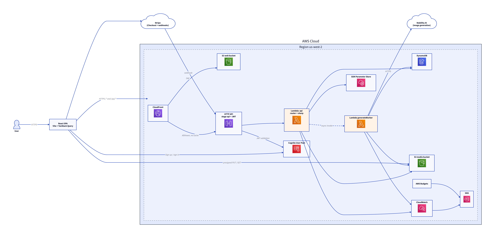
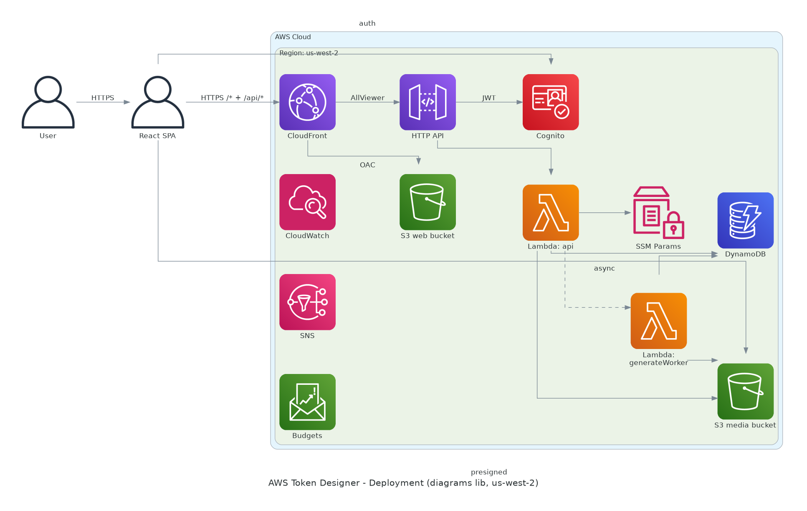

# Diagram comparison: PlantUML vs D2 vs Python `diagrams`

> **Outcome (2026-11-10, ADR-0010): D2 is the standard.** PlantUML was
> dropped. This document is kept as the evaluation record.

Same architecture, three code-driven renderers. D2 won on readability and
authoring experience; the D2 output was promoted to
`docs/diagrams/aws-deployment.*`.

| | ~~PlantUML + `aws-icons-for-plantuml`~~ (removed, ADR-0010) | D2 + Terrastruct icons (standard) | Python `diagrams` + Graphviz (reference) |
|---|---|---|---|
| Source | ~~`docs/diagrams/aws-deployment.puml`~~ | `docs/diagrams/aws-deployment.d2` (`compare/d2/` holds the original trial) | `compare/diagrams/aws_deployment.py` |
| Render | ~~`./scripts/render-diagrams.sh` (Docker `plantuml/plantuml`, icons pinned at v23.1 in `.cache/`)~~ (removed) | `compare/d2/render.sh` (Docker `terrastruct/d2`) | `compare/diagrams/render.sh` (Docker `python:3.11-slim` + Graphviz) |
| Exports | `docs/diagrams/aws-deployment.svg` / `.png` | `compare/d2/aws-deployment.svg` / `.png` | `compare/diagrams/aws-deployment.svg` / `.png` |

## A. PlantUML (former baseline, removed)


*(The PlantUML source was removed per ADR-0010; the image above now shows
the D2 output. The original evaluation text is preserved below for the
record.)*

## B. D2



## C. Python `diagrams`



## Comparison

| Criterion | PlantUML | D2 | Python `diagrams` |
|---|---|---|---|
| Icon fidelity | Official AWS Architecture Icons (pinned sprite set, correct category colors) | Terrastruct-hosted AWS icons (close to official; SSM/Budgets fell back to generic) | Bundled AWS icons (large, colorful, official-style) |
| Layout quality | Orthogonal routing, compact; a few long arrows (SPA → Cognito, SPA → S3 media) but readable | Auto-layout with curved edges; sprawling — region box dominates, some labels overlap edges (`webhook`, `OAC`, `AllViewer`) | Graphviz dot layout; clean icon grid but edge routing is rough (stray `auth`/`presigned` labels, crossing edges) |
| Containers/boundaries | AWS Cloud + region groups with conventional styling | AWS Cloud + region containers render well (light blue fill) | AWS Cloud + region clusters render cleanly |
| Ease of change | Edit `.puml`, re-run script; must learn `awslib` include paths and `!define` macros | Edit `.d2`, re-run; simplest syntax of the three; icon URLs are plain strings | Edit `.py`, re-run; Python API is familiar but node/edge code is verbose |
| Reviewability | Good — text diff on the `.puml` | Best — minimal, readable DSL diffs | OK — Python diffs, but layout is implicit |
| Setup/ops | Docker only; icon set pinned in `.cache/` via `fetch-aws-icons.sh` | Docker only; icons fetched at render time from `icons.terrastruct.com` (network dependency, no pinning) | Docker only; slowest build (apt Graphviz + pip install on every run) |
| Output quality | Closest to the official AWS look of the three; good enough for arch docs as-is | Modern and readable; icon + label pairing is nice, but the layout needs hand-tuning for stakeholder use | Icon-forward and bold, but edge routing/label placement is the weakest; needs the most polish |
| Portfolio-ready? | Yes, with a short polish pass | Nearly — fix label overlaps and tighten the region layout | Not directly — use as an icon reference or rework edges |

## Takeaways (recorded in ADR-0010)

1. **D2 is the standard.** Most readable output, simplest source, one
   toolchain. Promoted to `docs/diagrams/aws-deployment.*`.
2. **PlantUML dropped.** Official icon set and reproducibility were
   outweighed by readability and authoring cost for this project.
3. **Python `diagrams` not adopted.** Graphviz auto-layout fights this
   topology; kept as a reference only.
4. **draw.io is still the maximum-polish option.** Import the D2 SVG or the
   Mermaid source and hand-place AWS shapes — see `drawio/README.md`. Do it
   once per milestone, not per commit.

## Regenerate everything

```bash
./scripts/render-diagram.sh                      # D2 deployment snapshot
./docs/diagrams/compare/diagrams/render.sh    # Python diagrams reference (optional)
```

**Last updated:** 2026-11-10
